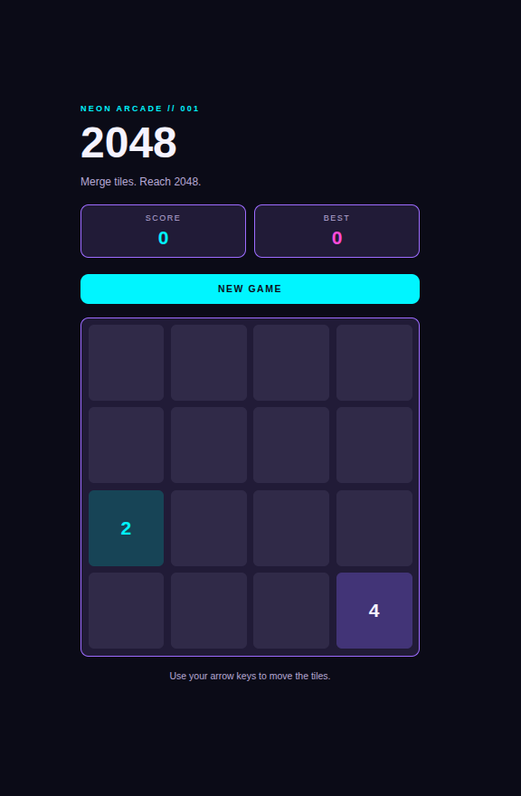
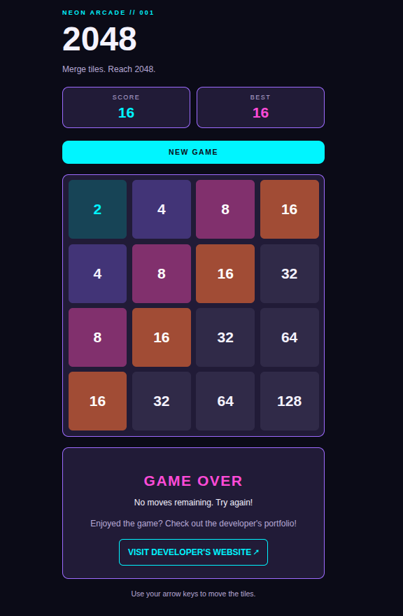
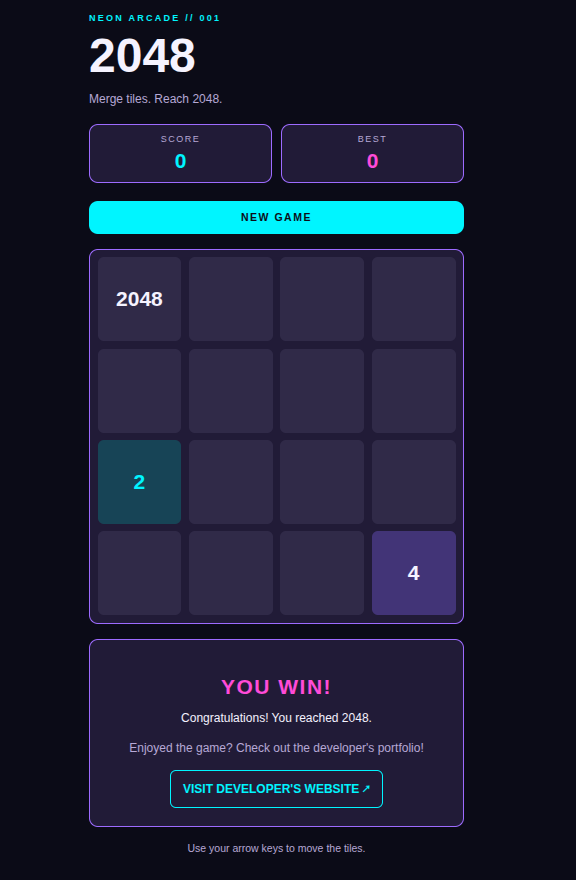
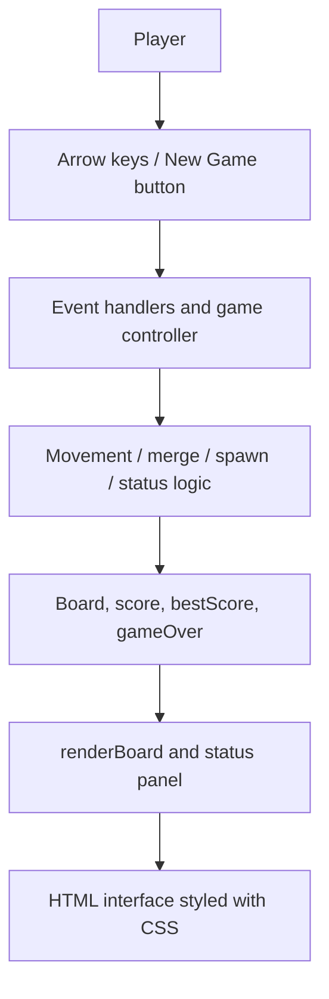
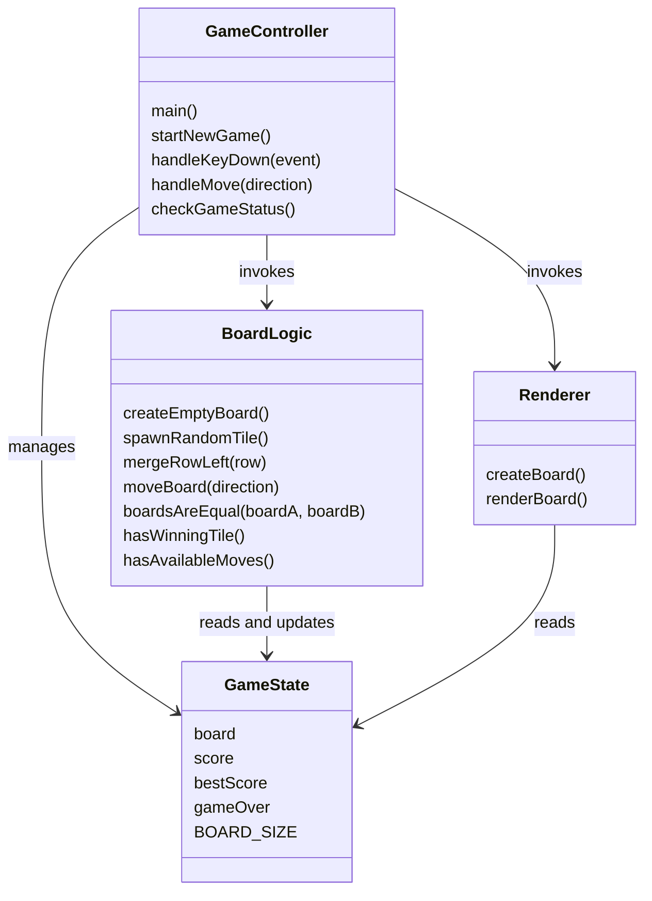
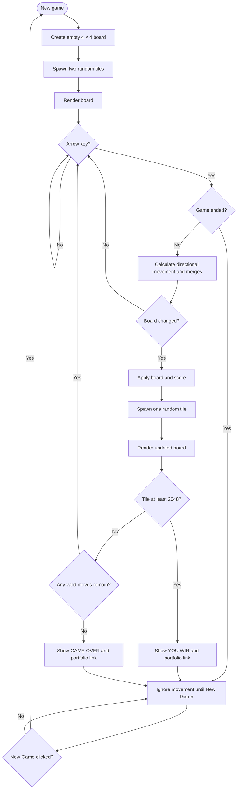
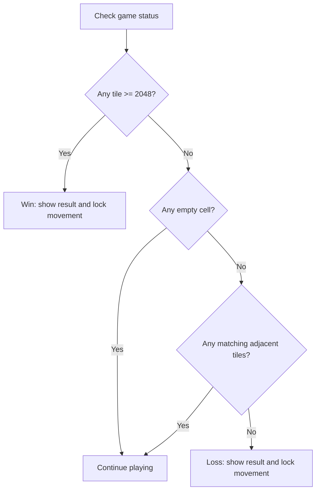

# 2048 | Neon Arcade

A neon, cyberpunk-inspired browser adaptation of the [2048 puzzle game](https://github.com/gabrielecirulli/2048), built using **HTML5, CSS3, and vanilla JavaScript**. This is an educational project focused on learning front-end fundamentals, algorithms, event-driven programming, and DOM manipulation without a framework or backend.

> **Project status:** Core gameplay, keyboard controls, win/loss detection, and end-of-game messages have been manually tested. Final code review and GitHub Pages deployment are pending.

## Screenshots

| New game | Game over |
| --- | --- |
|  |  |

**Simulated win-condition test** (a 2048 tile was inserted using the browser Console; the score of zero does not represent a completed playthrough):



## How to play

Use the **arrow keys** to slide all tiles up, down, left, or right. Equal-valued tiles that collide merge into a tile worth twice as much. Reach **2048** to win. The game ends if the board has no empty spaces and no adjacent equal-valued tiles that can merge.

Click **NEW GAME** to restart. Once the game reaches a win or loss condition, keyboard movement is locked until a new game begins. The end-of-game panel offers an optional link to the [developer's portfolio](https://stennethswaby.github.io/website/), which opens in a new tab.

## Features

- Responsive 4 × 4 grid with a dark, neon-inspired design
- Arrow-key controls for four-directional movement
- Tile merging and score tracking
- Random tile spawning after valid moves (90% value **2**, 10% value **4**)
- Win detection at **2048** and loss detection when no moves remain
- Keyboard lockout at either end state and a **NEW GAME** reset
- Best-score tracking during the current page session
- End-of-game invitation to visit the developer's portfolio

The game runs entirely in the browser. It does **not** use a database, backend, accounts, or persistent storage. Refreshing the page resets the in-memory game state, including the best score.

## Technology stack

| Technology | Responsibility |
| --- | --- |
| HTML5 | Semantic page structure, scoreboard, controls, board container, result panel |
| CSS3 and CSS Grid | Responsive layout, four-column board, neon colors, interactive styling |
| Vanilla JavaScript | Game state, random tile spawning, movement, merging, score updates, status checks |
| Browser DOM API | Creating and updating cells and result messages |
| Git and GitHub | Version control and source-code hosting |
| Mermaid | Architecture and game-flow diagrams rendered by GitHub |

No external JavaScript libraries, package manager, or build step are required.

## Project structure

```text
2048/
├── index.html       # Semantic game interface
├── style.css        # Cyberpunk theme and responsive layout
├── script.js        # State, movement, rendering, and game rules
├── images/
│   ├── new-game.png
│   ├── game-over.png
│   ├── win-test.png
│   └── win-lockout.png
└── README.md        # Project documentation
```

## Application architecture

The board is stored as a **4 × 4 two-dimensional JavaScript array**. A value of `0` means an empty cell. This array is the source of truth: JavaScript processes input and changes the array, then `renderBoard()` updates the displayed HTML cells.



### UML-style logical component diagram

The implementation uses **functions and shared state**, not JavaScript classes. This diagram groups functions by their responsibilities rather than depicting literal classes in the source code.



### Game-flow diagram



## How movement and merging work

The game reuses a **left-merge algorithm** for all four directions. For right moves, it reverses each row, merges left, then reverses the result. For up and down moves, it extracts columns, merges them in the appropriate order, and writes the results back.

For example, moving left:

```text
Original:       [2, 0, 2, 4]
Remove zeros:   [2, 2, 4]
Merge matches:  [4, 4]
Pad with zeros: [4, 4, 0, 0]
```

Each newly merged tile contributes its value to the score. A tile can merge only once per move, so `[2, 2, 2, 2]` becomes `[4, 4, 0, 0]`, **not** `[8, 0, 0, 0]`.

A move that does not change the board must not spawn a new tile. A valid move creates exactly one new tile in an empty cell.

## Win and loss detection

- **Win:** `hasWinningTile()` checks whether any cell contains a value of 2048 or higher.
- **Loss:** `hasAvailableMoves()` checks for an empty cell or horizontally/vertically adjacent equal tiles. A full board alone does not necessarily mean game over.
- **Controller:** `checkGameStatus()` displays the appropriate result panel and sets `gameOver`. `handleMove()` ignores further moves until `startNewGame()` resets the state.



## Testing

Manual browser and Console tests completed:

| Test | Result |
| --- | --- |
| New game displays two starting tiles | Passed |
| Arrow keys move tiles in all four directions | Passed (manual play) |
| Matching tiles merge and increase score | Passed (manual play) |
| Simulated 2048 tile displays winning panel | Passed |
| Full board without possible merges displays game-over panel | Passed |
| Keyboard input is locked after win and loss | Passed |
| Portfolio link opens the developer's website | Passed |

**Additional checks before release:** test that invalid moves never change the score or spawn tiles; verify merging edge cases (such as `[2, 2, 2, 2]`); test narrow mobile screens and keyboard focus. These checks are not marked as completed here.

### Example game-over test board

```javascript
board = [
    [2, 4, 8, 16],
    [4, 8, 16, 32],
    [8, 16, 32, 64],
    [16, 32, 64, 128]
];
renderBoard();
checkGameStatus();
```

### Example simulated win test

```javascript
board[0][0] = 2048;
renderBoard();
checkGameStatus();
```

These are manual testing commands entered into the browser's Developer Tools Console; they are not part of normal gameplay.

## Run locally

```bash
git clone https://github.com/StennethSwaby/2048.git
cd 2048
python3 -m http.server 8000
```

Open **http://localhost:8000** in your browser. Press `Ctrl+C` in the terminal to stop the local server. Python 3 is only used to serve the static files during development.

> The repository link is the intended public repository. Confirm the code has been pushed before using the clone instructions.

## Development approach and future improvements

This project was developed incrementally: HTML structure, CSS layout, board state, random tile generation, DOM rendering, directional movement, scoring, end-state detection, and keyboard lockout. Each feature was tested in the browser before proceeding.

Potential improvements include animated tile movement, richer colors for larger tile values, mobile swipe controls, automated tests, and improved screen-reader support.

## References and acknowledgments

1. **Cirulli, G.** [*2048*](https://github.com/gabrielecirulli/2048). Original 2048 game and its publicly available source code (MIT-licensed). The gameplay concept and merge mechanics in this project are inspired by Cirulli's work. This project is an independently implemented educational adaptation, not an official version or an affiliation with the original creator.
2. **Mozilla Developer Network (MDN).** [*CSS Grid Layout*](https://developer.mozilla.org/en-US/docs/Web/CSS/CSS_grid_layout). Reference for the four-column board layout.
3. **Mozilla Developer Network (MDN).** [*JavaScript Array*](https://developer.mozilla.org/en-US/docs/Web/JavaScript/Reference/Global_Objects/Array). Reference for array-based board representation and operations.
4. **Mozilla Developer Network (MDN).** [*Document.createElement()*](https://developer.mozilla.org/en-US/docs/Web/API/Document/createElement). Reference for generating board cells dynamically.
5. **GitHub Docs.** [*Creating diagrams*](https://docs.github.com/en/get-started/writing-on-github/working-with-advanced-formatting/creating-diagrams). Reference for Mermaid diagrams in Markdown.
6. **OpenAI.** [*ChatGPT*](https://chatgpt.com/). Used as an educational and coding assistant for explaining concepts, suggesting implementation steps, reviewing and debugging JavaScript, and drafting project documentation and diagrams. The application was iteratively implemented and manually tested during development.

## Developer

**Stenneth Swaby** — Computer Science Graduate · U.S. Navy Veteran

- [Portfolio](https://stennethswaby.github.io/website/)
- [GitHub](https://github.com/StennethSwaby)

## License

No license has yet been selected for this repository. Before publishing a reusable open-source release, choose a license and review any third-party material incorporated into the project.